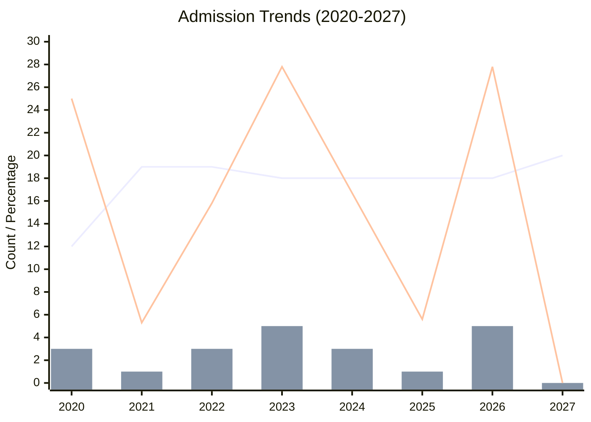

<!--more-->

Due to the changes in policy regarding (125601) MEM and related programs beginning in 2027, other disciplines, e.g., (120100) Management Science & Engineering, might be impacted to a certain extent. Therefore, the following records and predictions are necessary.

**(120100) Management Science & Engineering**

|Year|Admission Quota|First-Choice Applicants|First-Choice Admissions|Share of First-Choice Admissions|
|:---:|:---:|:---:|:---:|:---:|
|2020|12|24|3|25%|
|2021|19|45|1|5.3%|
|2022|19|52|3|15.8%|
|2023|18|42|5|27.8%|
|2024|18|14|3|16.7%|
|2025|18|*unknown*|1?|5.6%|
|2026|18|*unknown*|5?|27.8%|
|2027|20|*unknown*|*TBD*|*TBD*|

