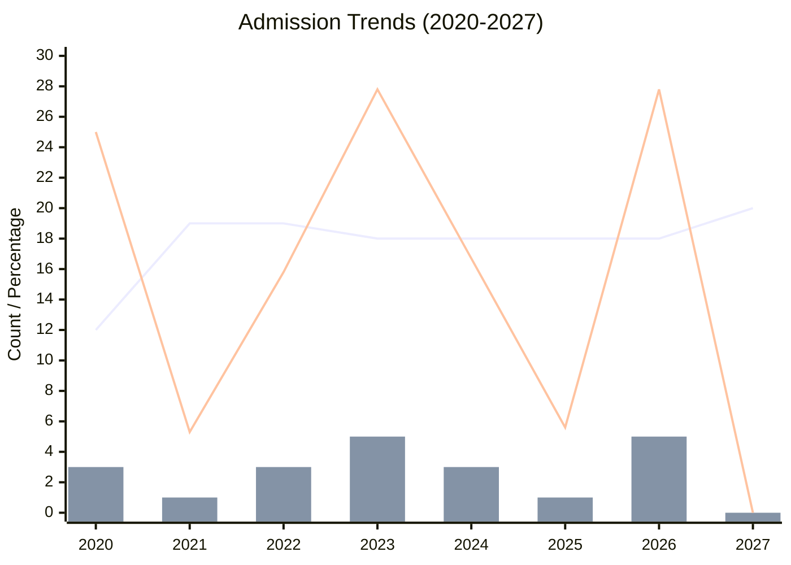
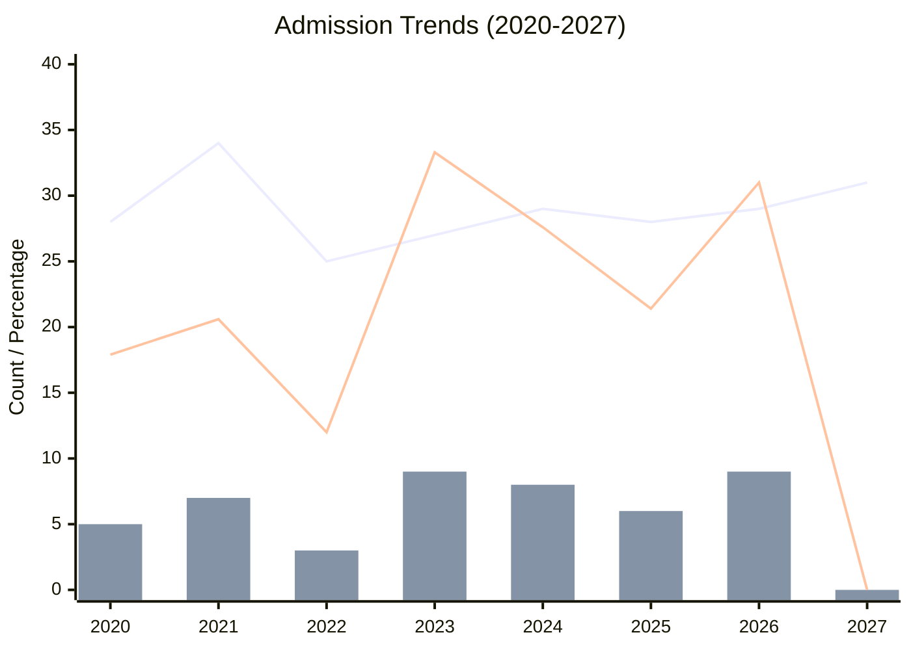

<!--more-->

## Management Science & Engineering

Due to the changes in policy regarding (125601) MEM and related programs beginning in 2027, other disciplines, e.g., (120100) Management Science & Engineering, might be impacted to a certain extent. Therefore, the following records and predictions are necessary.

|Year|Admission Quota|First-Choice Applicants|First-Choice Admissions|Share of First-Choice Admissions|
|:---:|:---:|:---:|:---:|:---:|
|2020|12|24|3|25%|
|2021|19|45|1|5.3%|
|2022|19|52|3|15.8%|
|2023|18|42|5|27.8%|
|2024|18|14|3|16.7%|
|2025|18|*unknown*|1?|5.6%|
|2026|18|*unknown*|5?|27.8%|
|2027|20|*unknown*|*TBD*|*TBD*|
|2028|||||

---

## Applied Economics

|Year|Admission Quota|First-Choice Applicants|First-Choice Admissions|Share of First-Choice Admissions|
|:---:|:---:|:---:|:---:|:---:|
|2020|28|28|5|17.9%|
|2021|34|73|7|20.6%|
|2022|25|84|3|12%|
|2023|27|64|9|33.3%|
|2024|29|45|8|27.6%|
|2025|28|*unknown*|6?|21.4%|
|2026|29|*unknown*|9?|31%|
|2027|31|*unknown*|*TBD*|*TBD*|
|2028|||||

